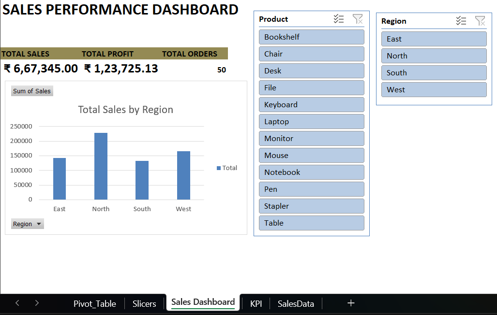

# Sales Performance Dashboard (Microsoft Excel)

An interactive Excel dashboard that summarises sales performance by region and product, built with PivotTables, PivotCharts and slicers.

## Objective

Give a quick, filterable view of total sales, profit and orders, and show which regions and products perform best.

## Dataset

- Sample sales dataset used for practice (50 orders)
- 12 products (Bookshelf, Chair, Desk, File, Keyboard, Laptop, Monitor, Mouse, Notebook, Pen, Stapler, Table)
- 4 regions (East, North, South, West)
- Key fields: Product, Region, Sales, Profit

## Tools and Skills Used

- Microsoft Excel
- PivotTables and PivotCharts
- Slicers (Product, Region)
- KPI cards (Total Sales, Total Profit, Total Orders)
- Data cleaning

## What I Did

1. Cleaned the data, including removing blank product entries
2. Built PivotTables for sales, profit and order count
3. Created a PivotChart showing total sales by region
4. Added Product and Region slicers so the dashboard can be filtered interactively
5. Laid out KPI cards and charts on a single dashboard sheet

## Key Insights

- **Total sales:** ₹6,67,345, **total profit:** ₹1,23,725, from **50 orders**
- **Overall profit margin:** about 18.5%
- **Average order value:** about ₹13,350
- **Top region:** North contributed roughly one-third of total sales; South was the lowest
- **Top product:** Stapler had the highest sales (₹1,55,207) and profit (₹26,158.62), about 23% of total sales, with most of its sales coming from the South and West regions

## Files in This Repository

- `Sales_Dashboard.xlsx` – the Excel workbook with the data, PivotTables and dashboard
- `dashboard.png` – screenshot of the dashboard

## How to Use

Download the workbook, open the **Sales Dashboard** sheet, and click items in the Product and Region slicers to filter the KPI cards and chart.

## Next Steps

- Add a profit-by-region chart
- Rebuild the same dashboard in Power BI
